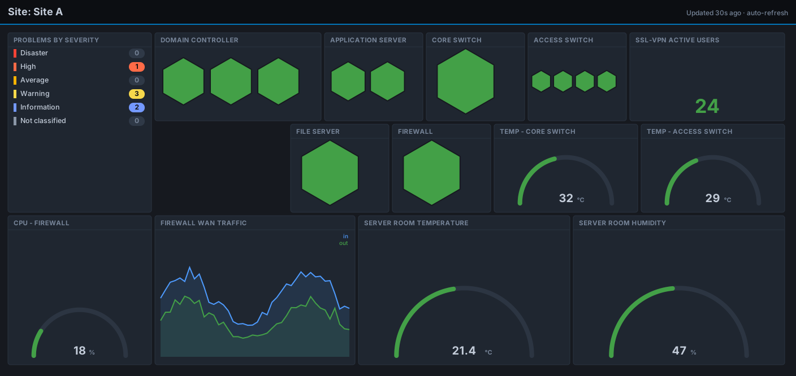

# Zabbix per site dashboard generator

A Bash script that **automates the creation of a Zabbix dashboard for each
site**, built entirely through the JSON-RPC API. It is meant for environments
where every site follows a similar infrastructure pattern (a firewall, core and
access switches, a few servers, a room sensor), so one script produces a
consistent dashboard for all of them instead of building each one by hand.

Everything is editable: the site list, the host naming prefixes, the widgets
and their layout all live in the script and can be adapted to your own setup.



*Illustrative mockup of the generated layout. Each site gets the same
structure, populated with that site's own hosts.*

## What each generated dashboard shows

For a single site, on one page:

- **Problems by severity** for the site.
- **Honeycomb health grids** per role: domain controllers, application servers,
  file servers, core and access switches, and the firewall. Each cell is one
  host, green when up and red when down.
- **SSL-VPN active users**.
- **Temperature gauges** for the core switch, access switch and server room.
- **Server room humidity** (only when a room sensor host exists).
- **CPU gauge** and a **WAN traffic graph** (in/out) for the firewall.

## How it works

For each site the script:

1. discovers the relevant hosts by name prefix (firewall, core switch, access
   switch, room sensor),
2. looks up the item ids it needs for the gauges,
3. builds the dashboard JSON (widgets are only added when the underlying host
   and item actually exist, so a site missing a device simply gets a smaller
   dashboard),
4. creates the dashboard, or **updates it in place** if it already exists.

Because it updates in place, re-running the script is also how you roll a layout
change out to every site at once.

## Adapting it to your infrastructure

The script assumes a consistent host naming scheme and a set of templates /
item names. To use it in your environment, edit:

- `SITES` : the site code to display name map.
- the host naming prefixes in the discovery block (firewall, switches, sensor).
- the item names referenced by the gauges, to match your templates.
- `ZABBIX_URL`, the `Host` header, and the API credentials.

## Usage

```bash
./zabbix_create_dashboards.sh
```

> The site list and the `Host` header are placeholders. Replace them, along
> with the host naming prefixes, with your own scheme.
